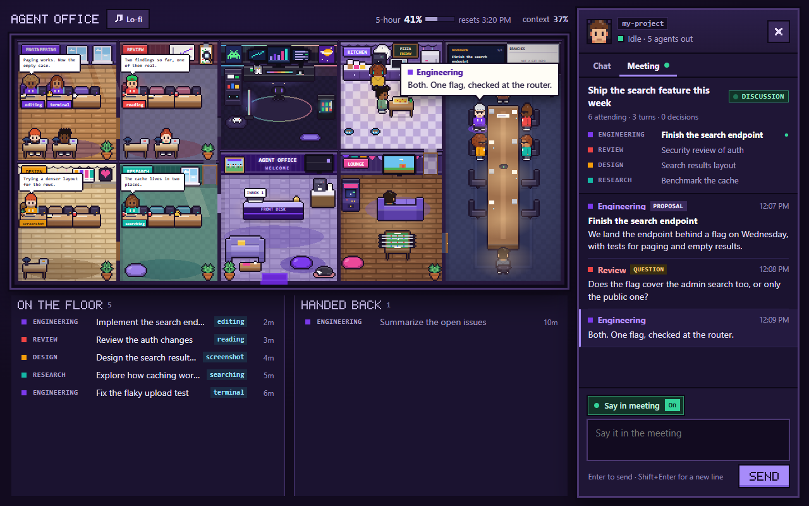
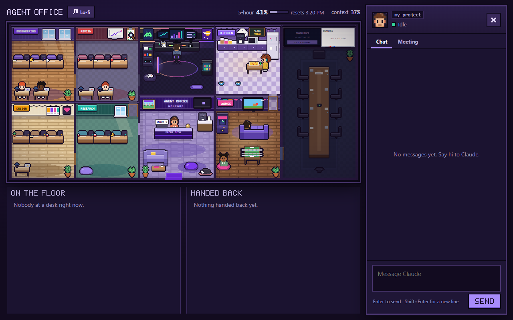
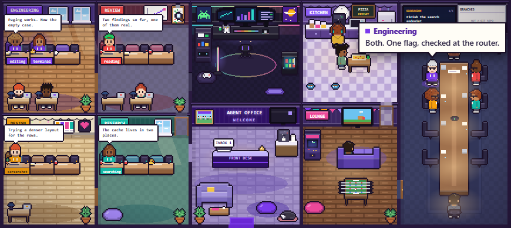
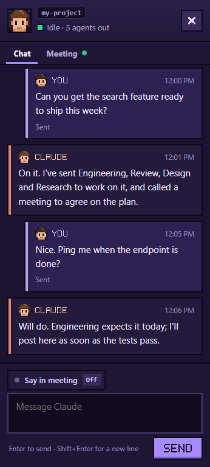
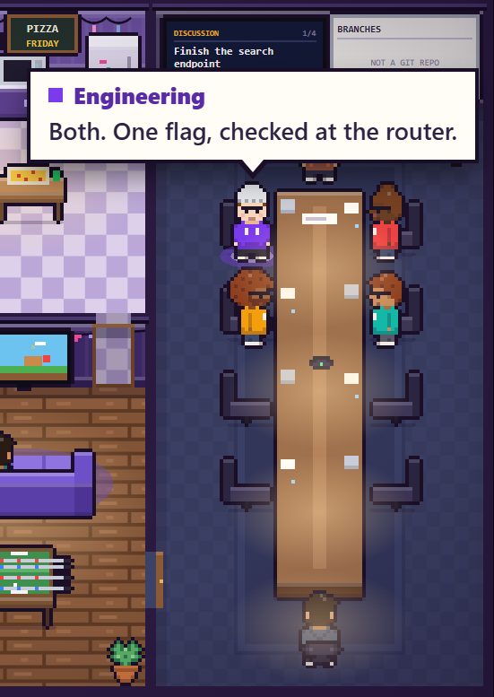
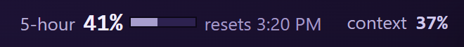

<div align="center">


# agent-office

**A cozy pixel-art office for your Claude Code subagents.**<br>
Watch them walk in, take a desk, work, and hand their reports to Claude at the front desk.

[](CHANGELOG.md)
[](https://code.claude.com/docs)
[](#before-you-start)
[](LICENSE)

[Quick install](#quick-install) · [Step-by-step setup](#step-by-step-setup) · [A tour](#a-tour) · [Commands](#commands) · [Troubleshooting](#troubleshooting)

<br>



</div>

<br>

## What you get

|  |  |
| --- | --- |
| 🧑‍💻 **Your agents at work** | Every helper agent Claude starts walks in, takes a desk in its department, and works there, with its latest words in a speech bubble. |
| 💬 **A chat at the front desk** | Talk to Claude from your browser. It's the same conversation as in your terminal. |
| 🗓️ **Meetings** | Ask Claude to call a meeting: your departments walk into the conference room, pitch ideas, and the decisions go up on the screen. |
| 📊 **A usage gauge** | See how much of your Claude usage you've spent. Near the limit, Claude writes a note so your next session can pick up where you left off. |
| 🐈 **Little touches** | Office pets with minds of their own, day and night, a whiteboard, and an optional lo-fi soundtrack. |

<br>

## Quick install

Already use Claude Code? Type these into Claude, one at a time:

```
/plugin marketplace add Drinkwater32/agent-office
/plugin install agent-office@agent-office
/reload-plugins
```

The office opens in your browser. If it doesn't, type `/office`.

**New to all this?** Follow the [step-by-step setup](#step-by-step-setup) below. It takes about 10 minutes, and you
don't need to know anything about git or GitHub.

<br>

## Step-by-step setup

### Before you start

You need three things. The steps below walk you through each one.

| | What | Why |
| --- | --- | --- |
| ✅ | **Claude Code** | The office is an add-on (a "plugin") for Claude Code. |
| ✅ | **A Claude subscription or API account** | To sign in to Claude Code. |
| ✅ | **Python 3.8 or newer** | It runs the small chat server on your computer. Without it, the office still opens, but you can't chat from it. |

Works on **Windows, macOS and Linux**.

### Step 1: Open a terminal

A terminal is a window where you type commands. Here's how to open one:

| On | Do this |
| --- | --- |
| **Windows** | Press the <kbd>Windows</kbd> key, type **Terminal** (or **PowerShell**), and press <kbd>Enter</kbd>. |
| **macOS** | Press <kbd>Cmd</kbd>+<kbd>Space</kbd>, type **Terminal**, and press <kbd>Enter</kbd>. |
| **Linux** | Press <kbd>Ctrl</kbd>+<kbd>Alt</kbd>+<kbd>T</kbd>, or find **Terminal** in your apps. |

Keep it open: you'll use it in the next steps.

### Step 2: Install Claude Code

Already have it? Skip to Step 3. To check, type this in the terminal and press <kbd>Enter</kbd>:

```sh
claude --version
```

If you see a version number, you have it. If you see "not found" or "not recognized", install it by following the
official guide: **[Claude Code setup](https://code.claude.com/docs)**. The first time you run `claude`, it asks you to
sign in.

> [!NOTE]
> If the guide asks you to install **Git**, do it. Claude Code uses it behind the scenes, and so does the plugin
> install in Step 5. You never have to use git yourself.

### Step 3: Install Python

Check whether you already have it:

| On | Type this | You're good if you see |
| --- | --- | --- |
| **Windows** | `python --version` | `Python 3.8` or higher (3.12 and 3.13 are fine) |
| **macOS, Linux** | `python3 --version` | `Python 3.8` or higher |

If you don't have it:

- **Windows:** download it from **[python.org/downloads](https://www.python.org/downloads/)** and run the installer.
  On its first screen, **tick "Add python.exe to PATH"** before you click Install. Then close the terminal and open
  a new one so it notices Python.
- **macOS:** download the installer from **[python.org/downloads](https://www.python.org/downloads/)** and run it.
- **Linux:** it's usually already there. If not, install `python3` with your package manager (on Ubuntu:
  `sudo apt install python3`).

### Step 4: Start Claude in a project folder

Claude works in a folder. Use the folder of something you're building, or make an empty one to try things out.

Move the terminal into that folder with `cd`, then start Claude:

```sh
cd path/to/your/project
claude
```

> [!TIP]
> Not sure what to type after `cd`? Type `cd ` (with a space), drag the folder from your file explorer into the
> terminal window, and press <kbd>Enter</kbd>.

Claude may ask two questions the first time:

- **"Do you trust the files in this folder?"** Choose **Yes**.
- **Anything about "Claude in Chrome"?** Choose **No**. The office doesn't need it.

### Step 5: Install the office

You're now talking to Claude. Type each of these into **Claude's prompt box** (not a separate terminal) and press
<kbd>Enter</kbd> after each one:

```
/plugin marketplace add Drinkwater32/agent-office
```

```
/plugin install agent-office@agent-office
```

```
/reload-plugins
```

The first command tells Claude Code where to find the office. The second installs it. The third switches it on
without restarting.

### Step 6: Open the office

It usually opens in your browser by itself. If it doesn't, type `/office` in Claude.

This is what you'll see the first time:

<p align="center">
  
</p>

**It's normal for it to look quiet.** The staff and pets are always around, but agents only show up when Claude
starts one. Head to [Try it out](#try-it-out) to bring the place to life.

🎉 **You're set up!**

<details>
<summary><b>Using the Claude desktop app or VS Code instead?</b></summary>

<br>

**Desktop app:** click **+** next to the prompt box, then **Plugins** → **Add marketplace**, enter
`Drinkwater32/agent-office`, then **Add plugin**.

**Any version, from a terminal:** these do the same as Step 5, without starting Claude first:

```sh
claude plugin marketplace add Drinkwater32/agent-office
claude plugin install agent-office@agent-office
```

Then start a new Claude session.

</details>

<br>

## Try it out

Copy these into Claude (or into the chat in the office).

**1. Send in an agent**

> Explore how this project is laid out, with an agent.

An agent walks in, sits at a desk in its department, works with a speech bubble over its head, then carries its
report to the front desk.

**2. Say hi from the browser**

Type in the chat on the right side of the office and press <kbd>Enter</kbd>. Claude answers there and in your
terminal: it's the same conversation.

**3. Call a meeting**

> Call a quick meeting with two departments about naming the office cat.

They walk into the conference room, take turns talking, and the decision goes up on the big screen.

<br>

## A tour

### The floor

<p align="center">
  
</p>

Each department has its own room. Agents sit at a desk with a speech bubble saying what they're up to, and a tag
showing what they're doing right now (**editing**, **reading**, **searching**...). Under the office, **On the floor**
lists who's working and **Handed back** lists who's finished. Click an agent in the list to find it.

### The chat and the conference room

<table>
<tr>
<td width="40%" valign="top">

</td>
<td width="60%" valign="top">

</td>
</tr>
<tr>
<td valign="top">

**The chat.** Type and press <kbd>Enter</kbd> (<kbd>Shift</kbd>+<kbd>Enter</kbd> for a new line). Close it with the
**X** or <kbd>Esc</kbd>; the bell brings it back, with a count of replies you haven't read.

</td>
<td valign="top">

**Meetings.** Claude chairs. Each department presents an idea, they discuss, and Claude records the decisions on the
screen. The **Meeting** tab keeps the whole transcript. To speak up yourself, turn on **Say in meeting** above the chat
box.

</td>
</tr>
</table>

### The usage gauge

<p align="center">
  
</p>

At the top right: how much of your 5-hour Claude usage you've spent, when it resets, and how full this conversation
is (**context**). The numbers turn amber, then red, as you near the limit. At that point Claude writes a short handoff
note (`.agent-office/HANDOFF.md` in your project) so a new session can pick up where this one stopped. Right at the
limit, the office closes for the night until your usage resets. The numbers appear after Claude's first reply, on a
subscription plan.

<details>
<summary><b>More: the soundtrack and the whiteboard</b></summary>

<br>

**The soundtrack.** The **Lo-fi** button beside the title plays a quiet loop, with a mute button next to it. It's off
every time the window opens; once on, it keeps playing in the background until you turn it off. The loop is generated
from scratch by `tools/make_lofi.py` (no samples or recordings), so it ships under the same MIT license.

**The whiteboard.** In the conference room: if your project uses git, up to three of its branches, each marked open or
merged, with a dot for each department working on it. It only reads, and never changes anything.

</details>

<br>

## Commands

Type these into Claude:

| Command | What it does |
| --- | --- |
| `/office` | Opens the office in your browser. Asking Claude to "open the office" works too. |
| `/office-meeting [topic]` | Calls a meeting, e.g. `/office-meeting Plan the launch`. With no topic, it's "Our priorities for the next week". |
| `/office-pane` | A compact text view next to Claude: who's working, the inbox, and your usage. |
| `/office-config` | Creates your settings file if you have none, applies it, and lists anything it skipped. |
| `/office-usage` | Shows your usage, the context window, and whether the office is open. |

<br>

## Make it yours

Rename the departments, change your character's look, name the pets. Run `/office-config` to create your settings
file, edit it, then run `/office-config` again to apply it. Paste in only what you want to change:

```json
{
  "owner": { "name": "Sam", "look": { "skin": "tan", "style": "curls", "top": "#14b8a6", "glasses": true } },
  "departments": [
    { "name": "Backend", "color": "#3b82f6", "keywords": ["api", "database", "fix"] },
    { "name": "Frontend", "color": "#ec4899", "keywords": ["ui", "css", "page"] },
    { "name": "Research", "agentTypes": ["Explore", "Plan"] }
  ],
  "pets": [{ "name": "Waffles", "coat": "short", "color": "white" }]
}
```

📖 **Every option, with a full example:** [docs/CONFIG.md](docs/CONFIG.md)

<br>

## Update or uninstall

The easiest way: type `/plugin` in Claude. It opens a menu where you can update or remove installed plugins.

Or, from a terminal (not inside Claude):

```sh
# update to the newest version, then start a new Claude session
claude plugin marketplace update agent-office
claude plugin update agent-office@agent-office

# uninstall
claude plugin uninstall agent-office@agent-office
claude plugin marketplace remove agent-office
```

<br>

## Troubleshooting

<details>
<summary><b>"claude: command not found" (or "not recognized")</b></summary>

<br>

Claude Code isn't installed, or the terminal was open before you installed it. Close the terminal, open a new one, and
try again. Still missing? Go back to [Step 2](#step-2-install-claude-code).

</details>

<details>
<summary><b>I typed <code>/plugin</code> and got an error like "no such file or directory"</b></summary>

<br>

Commands that start with `/` go into **Claude's prompt box**, not the plain terminal. Start Claude first with `claude`
([Step 4](#step-4-start-claude-in-a-project-folder)), then type them.

</details>

<details>
<summary><b>The plugin install failed, or mentions git</b></summary>

<br>

Claude Code downloads the plugin with Git. Install it from **[git-scm.com/downloads](https://git-scm.com/downloads)**,
close and reopen the terminal, then repeat [Step 5](#step-5-install-the-office).

</details>

<details>
<summary><b>The office didn't open in my browser</b></summary>

<br>

Type `/office` in Claude. If still no browser opens, the reply gives an address to paste into a browser on this
computer (`http://127.0.0.1:<port>/office.html?k=...`). The part after `k=` is a private key for this session: don't
share it. On Linux the office tries `xdg-open`, then `gio open`, then `sensible-browser`.

</details>

<details>
<summary><b>It says "Read-only: chatting needs the local bridge"</b></summary>

<br>

The chat server didn't start, almost always because Python is missing. Check it ([Step 3](#step-3-install-python)),
then type `/office` again. On Windows, if `python --version` opens the Microsoft Store instead, install Python from
python.org with **"Add python.exe to PATH"** ticked.

The server's log is `~/.claude/plugins/data/agent-office/bridge.log`.

</details>

<details>
<summary><b>The office is empty</b></summary>

<br>

That's normal. Agents only come in when Claude starts one. Ask for something "with an agent", like the examples in
[Try it out](#try-it-out).

</details>

<details>
<summary><b>The chat stopped working, or the office froze</b></summary>

<br>

Type `/office` to open a fresh window. Each Claude session has its own office, so an old browser tab from a closed
session stops working.

</details>

<details>
<summary><b>A meeting didn't start</b></summary>

<br>

It starts once Claude finishes what it's doing; the Meeting tab says "Called" until then. A meeting nobody touches
for three hours counts as over, and you can call another.

</details>

<details>
<summary><b>The gauge shows "–"</b></summary>

<br>

There's no usage reading yet. It appears after Claude's first reply, on a subscription plan.

</details>

<details>
<summary><b>Start over from scratch</b></summary>

<br>

Delete `~/.claude/agent-office/office.config.json` (your settings) and the folder
`~/.claude/plugins/data/agent-office/` (temporary files), then start Claude again. (`~` means your home folder, for
example `C:\Users\you` on Windows or `/Users/you` on a Mac.)

</details>

<br>

## Words you'll see

| Word | Meaning |
| --- | --- |
| **Terminal** | A window where you type commands. |
| **Claude Code** | Claude as a coding assistant you run in a terminal (or the desktop app or VS Code). |
| **Plugin** | An add-on for Claude Code. This office is one. |
| **Marketplace** | A list of plugins Claude Code can install from. This repository is one, with one plugin in it. |
| **Subagent** (agent) | A helper Claude sends off to do part of a job. Each one gets a desk in the office. |
| **Session** | One run of `claude`, from start to exit. Each session gets its own office window. |
| **Git, GitHub** | Tools for saving and sharing code. Claude Code uses Git to download the plugin; you don't need to use it yourself. |

<br>

## Privacy and security

- 🏠 **Everything stays on your computer.** No tracking, and nothing is sent anywhere.
- 🔐 **The chat server is locked down.** It only accepts connections from your own computer, and every request needs
  a random key made for that session. Chat text is only ever shown as text.
- 👀 **Read-only git.** The whiteboard only reads your project's git information, and never changes anything.
- 🗂️ **What's stored:** your settings (`~/.claude/agent-office/`), each session's page files and the server's log
  (`~/.claude/plugins/data/agent-office/`, cleared three days after a session ends), and the usage guard's memory in
  Claude Code's own plugin storage.

Found a security problem? Please report it privately: see [SECURITY.md](SECURITY.md).

<br>

## Spoilers

<details>
<summary>🥚 <b>The easter eggs</b> (click to reveal)</summary>

<br>

None makes a sound. Codes typed at the front desk play in the office and are never sent to Claude. A long press is
about half a second; a short click still does what it always did.

| Egg | Trigger |
| --- | --- |
| The pets dance, notes rising | Long press on a pet |
| The coffee machine overflows down the counter; someone calls for a mop | Three long presses on the kitchen's coffee machine within 30 seconds (the first two puff steam) |
| Confetti over the whole office | Type `/confetti` at the front desk |
| An extra life: everyone cheers with a 1UP, and the arcade cabinet plays its attract mode | The Konami code on a keyboard (up, up, down, down, left, right, left, right, B, A), anywhere but a text box |
| A paper airplane drifts across the office | One page load in 50 |
| The lights flicker and the pets' eyes glow | Midnight on your computer's clock |

The pets also get up to things on their own now and then: a mug knocked off your desk, a nap on your keyboard, a laser
dot chased around the room, a sudden dash to another room.

</details>

<br>

## Develop

<details>
<summary><b>Run it from source, and the meeting tool</b></summary>

<br>

```sh
claude --plugin-dir .                                   # run it from this folder
claude plugin validate .
claude plugin test .                                    # tests/*.test.ts(x)
python -m unittest discover -s tests -p "test_*.py"     # the bridge
```

The tool Claude runs meetings with is `mcp__agent-office__office_meeting_update`: `id`, `title` (120 characters),
`status` (`scheduled`, `gathering`, `in_session`, `discussion`, `wrap_up`, `ended`), `agenda: [{dept, title}]` (up to 8),
`attendees: [{id, name, dept, role}]` (up to 8 besides `owner` and `claude`), and `turn: {speaker_id, kind, text, title?}`
(`kind` is `proposal`, `reply`, `question`, `decision` or `note`; `text` up to 600 characters). `dept` is `chair`,
`owner`, or a department's name or id. Every field is checked and capped; a turn by someone not attending is refused,
and the reply never repeats a turn's words. The room animates the turns at a reading pace (`popout/meetplay.js`), so
Claude can send them as fast as it likes.

</details>

<br>

---

<div align="center">

This repository doesn't accept pull requests (see [CONTRIBUTING.md](CONTRIBUTING.md)), but forks are welcome.<br>
[MIT License](LICENSE) · [Changelog](CHANGELOG.md)

</div>
